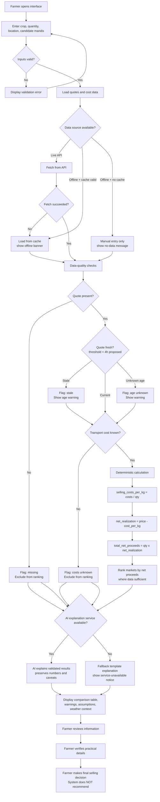

# KrishiVed Market Decision Support — Basic SRS & Version 1 Implementation Plan

---

## A. Document Control and Purpose

| Attribute | Value |
|-----------|-------|
| **Project name** | KrishiVed Market Decision Support |
| **Competition** | AI Synergy Hackathon 2026 — Round 1 |
| **Selected case** | Case 02 — Agriculture: The Harvest Decision Window |
| **Document title** | Basic Software Requirements Specification and Version 1 Implementation Plan |
| **Version** | 1.0 |
| **Status** | Proposed / Planned |
| **Date** | 2026-10-14 |
| **Purpose** | Define the software requirements, architecture, acceptance criteria, and implementation plan for a Version 1 transport-adjusted mandi comparison tool, suitable for evaluation by competition judges and for use as a build specification in Round 2. |
| **Intended audience** | Competition evaluators; Round 2 development team |
| **Relationship to Round 1 submission** | This document elaborates the SRS, workflow, AI/human responsibility model, acceptance tests, and implementation plan already presented in `SUBMISSION.md`. It introduces no new features, datasets, integrations, or test results beyond what the Round 1 submission documents establish. Where a detail is not fixed by existing project files, it is labeled as a proposal. |

**Integrity statement**: No team-member names, approvals, field trials, API integrations, benchmark results, or successful test outcomes are claimed in this document. All six acceptance tests carry status "Not run."

---

## B. Users and Stakeholders

| Stakeholder | Category | Role | Information needs | Interaction with the system |
|-------------|----------|------|-------------------|----------------------------|
| **Smallholder vegetable farmer** | Primary user | Decides when and where to sell perishable produce | Net proceeds per mandi after selling costs; quote freshness; weather context; assumptions affecting estimates | Enters crop, quantity, location, candidate mandis, cost estimates; reviews comparison and warnings; makes final selling decision |
| **Local aggregator / transporter** | Supporting stakeholder | Transports produce; validates cost estimates | Accurate transport and loading cost information for a given route and volume | May assist the farmer with data entry; validates transport-cost inputs; may view the same comparison output |
| **Mandi trader** | Supporting stakeholder (data source) | Sets or references market prices | Not a system user | System may source quotes attributed to traders (simulated in V1); trader does not interact with the system |
| **Agriculture extension worker** | Supporting stakeholder | Helps interpret weather and agronomic context | Weather forecast source, coverage, and limitations; crop-quality context | May help the farmer interpret weather warnings; not granted direct system access in V1 |
| **Farmer Producer Organisation (FPO)** | Supporting stakeholder | Collective decision-making, group selling | Aggregated comparison across members (future) | No V1 interaction; group-comparison feature is explicitly out of scope |
| **System administrator / data maintainer** | Operator | Configures data sources and thresholds | Data source status; freshness-threshold configuration; fixture integrity | Configures freshness threshold (default 4 hours), manages simulated fixture data; no access to farmer inputs |

**Access model**: No login or account creation is required for the primary farmer user. The V1 system collects no personally identifiable information (PII).

---

## C. System Scope and Boundaries

### C.1 Problem Being Solved

Smallholder vegetable farmers lack a reliable, accessible way to compare the expected net proceeds of selling a perishable crop across nearby mandis when quoted prices, transport costs, weather conditions, and connectivity vary. A mandi offering the highest quoted price may not produce the highest net proceeds after selling costs.

### C.2 Intended Purpose

Provide a transparent, deterministic comparison of estimated net proceeds across a small set of candidate mandis, with visible data-quality warnings and understandable explanations, while preserving farmer decision authority.

### C.3 In-Scope Features (Version 1)

| # | Feature |
|---|---------|
| 1 | Accept crop, quantity, origin location, and candidate mandis (up to 5) |
| 2 | Accept or load quoted prices, source metadata, and timestamps |
| 3 | Accept transport, loading, and unloading cost estimates |
| 4 | Calculate selling cost per kg, net realization per kg, and total expected net proceeds deterministically |
| 5 | Compare net proceeds across candidate mandis where data is sufficient |
| 6 | Display quote source, timestamp, and freshness status for every price |
| 7 | Flag missing, stale, conflicting, or unavailable data explicitly |
| 8 | Show weather/context information with source, update time, and geographic coverage label when available |
| 9 | Generate plain-language AI-assisted explanations of validated comparison results |
| 10 | Display offline/cached data with explicit freshness warnings |
| 11 | English-language interface |

### C.4 Out-of-Scope Features (Version 1)

- Price prediction or forecasting
- Harvest-timing optimization or crop-quality degradation modelling
- Autonomous selling, purchasing, or logistics booking
- Collective selling or group transport coordination
- SMS, IVR, WhatsApp, or voice interfaces
- Hindi or other language interfaces
- Nationwide mandi or crop coverage
- Guaranteed selling outcomes (price, income, yield, or waste reduction)
- Account creation, PII collection, or server-side storage of farmer inputs

### C.5 External Systems and Dependencies

| Dependency | Status | Classification |
|------------|--------|----------------|
| Simulated market fixture data (`tests/fixtures/*.json`) | Exists in repository | **Confirmed existing artifact** |
| Deterministic calculation engine | Specified; not yet implemented | **Proposed design** |
| Mandi price API (eNAM, state APMC) | Not connected; access not verified | **Future integration requiring verification** |
| Weather API (IMD, OpenWeatherMap) | Not connected; data structure defined | **Future integration requiring verification** |
| AI explanation service (LLM) | Prompt designed; not deployed | **Proposed design** |
| Offline cache (LocalStorage / Service Worker) | Behavior specified in acceptance tests; not implemented | **Proposed design** |

### C.6 Version 1 Boundaries

| Boundary | Value |
|----------|-------|
| Crop coverage | One crop per session |
| Mandi coverage | Up to 5 candidate mandis |
| Language | English only |
| Data source (development/testing) | Simulated fixtures, clearly labeled |
| Data source (prototype, if verified) | Live mandi API — not confirmed as integrated |
| Connectivity | Offline-capable with cache; no guarantee of complete offline operation |
| Decision authority | Farmer decides; system never recommends a mandi |

---

## D. Inputs and Outputs

### D.1 System Inputs

| Field / Input | Description | Data type / format | Required | Validation rules | Failure behaviour if missing or invalid |
|---------------|-------------|--------------------|----------|------------------|-----------------------------------------|
| `crop` | Crop being sold | String (enum: tomato, etc.) | Yes | Must match a supported crop identifier | Reject submission with message: "Select a crop." |
| `quantity_kg` | Quantity available to sell | Number (kg) | Yes | Must be > 0; unit explicitly kg | Reject if ≤ 0 or missing: "Quantity must be greater than zero." |
| `origin_location` | Farmer's village or cluster | String | Yes | Village/cluster level only; no GPS, no PII | Reject if empty: "Enter your village or cluster." |
| `candidate_markets` | List of mandis to compare (1–5) | Array of market objects | Yes | Array length 1–5 | Reject if empty or > 5: "Select between 1 and 5 mandis." |
| `market_id` | Unique market identifier | String | Yes | Unique within submission | Reject duplicates. |
| `market_name` | Display name of mandi | String | Yes | Non-empty | Reject if empty. |
| `distance_km` | Distance from origin to mandi | Number (km) | Proposed field — not finalized in source material | Must be ≥ 0 if provided | If missing, proceed; distance not used in core calculation (costs are entered directly). |
| `quoted_price_per_kg` | Quoted price from source | Number (₹/kg) | Yes (for comparison) | Must be > 0; unit must be ₹/kg | If null: mark market `data_freshness: "missing"`; exclude from ranking; display "—". Never invent a value. |
| `quote_source` | Origin of the quote (e.g., "simulated", "trader", "eNAM") | String | Yes | Non-empty; provenance must be preserved | If missing: flag as "source unknown"; do not present as verified. |
| `quote_timestamp` | ISO 8601 timestamp of quote | ISO 8601 string | Yes (for freshness check) | Valid ISO 8601; parsed against current time | If null: mark freshness "unknown"; display warning "Quote age cannot be determined." |
| `transport_cost_total` | Total transport cost for the trip | Number (₹ total) | Yes (for ranking) | ≥ 0; user-entered estimate or cached value | If missing: prompt user. If user declines: mark market "costs unknown"; exclude from net-proceeds ranking. Never default to zero. |
| `loading_cost_total` | Loading charges | Number (₹ total) | No | ≥ 0 if provided; default 0 only if explicitly confirmed unknown-and-zero by user | If not provided and user did not confirm zero: treat as unknown; exclude from ranking. |
| `unloading_cost_total` | Unloading charges | Number (₹ total) | No | ≥ 0 if provided | Same as loading cost. |
| `freshness_threshold_hours` | Configurable max quote age | Number (hours) | Yes (config) | > 0; proposed default 4 hours | System default applied if not set. Policy is a proposal, not a universal standard. |
| `weather_forecast` | Weather context object | JSON object | No | If present: must include `condition`, `source`, `source_timestamp`, `geographic_coverage` | If null or service fails: display "Weather data unavailable" with last-attempt timestamp; proceed without weather recommendation. |
| `connectivity` | Current connectivity state | Enum: "online" / "offline" | No | — | If offline: use cache if valid; display offline banner; allow manual entry. |

### D.2 System Outputs

| Output | Description | Unit / format | Source / calculation method | Associated warnings or limitations |
|--------|-------------|---------------|-----------------------------|-------------------------------------|
| `selling_costs_per_kg` | Total included selling costs divided by quantity | ₹ / kg | `(transport + loading + unloading) ÷ quantity_kg` | "Based on entered estimates; actual costs may differ." |
| `net_realization_per_kg` | Quoted price minus selling cost per kg | ₹ / kg | `quoted_price_per_kg − selling_costs_per_kg` | "Estimate only; does not account for cultivation cost, losses, or unmodelled charges." |
| `total_net_proceeds` | Quantity multiplied by net realization per kg | ₹ total | `quantity_kg × net_realization_per_kg` | "Estimated proceeds after included selling costs — not guaranteed." |
| `data_freshness` | Freshness status of each quote | Enum: `current` / `stale` / `missing` / `unknown` | Compared against `freshness_threshold_hours` | Stale: "Quote is N hours old (threshold: Xh)." Missing: "No quote available." |
| `ranked_comparison` | Markets ordered by total net proceeds (where sufficient data) | Ordered list | Deterministic sort on `total_net_proceeds` | Markets with missing quotes or unknown costs are excluded from ranking, shown separately. |
| `warnings` | Per-market data-quality warnings | Array of strings | Rule-based checks | Warnings never suppressed. |
| `assumptions_panel` | Collapsible list of assumptions affecting the comparison | Text list | System-generated from input metadata | Includes: transport estimate provenance, quote freshness, weather coverage, simulation labeling. |
| `ai_explanation` | Plain-language explanation of validated results | English paragraph (≤200 words proposed) | AI layer receiving only validated deterministic output | Must preserve all numbers, units, and caveats from engine output. Must not recommend a mandi. |
| `weather_context` | Weather condition, probability, source, timestamp, coverage | JSON + display text | Weather source (simulated or future API) | Must show geographic coverage label; must not be used to automate decisions. |
| `offline_banner` | Connectivity status indicator | Text + timestamp | Cache metadata | "Offline — showing cached data from [timestamp]." Never claims live data when cached. |

---

## E. Functional Requirements

Preserves the intent of existing FR-01 through FR-10 from `specs/01-solution-srs.md` and `SUBMISSION.md`.

| ID | Requirement statement | Rationale | Inputs | Expected output | Priority | Verification method | Dependencies |
|----|----------------------|-----------|--------|-----------------|----------|---------------------|--------------|
| **FR-01** | The system shall accept crop, quantity, origin location, and selling-window inputs from the farmer. | Core data entry enabling all downstream calculation. | `crop`, `quantity_kg`, `origin_location`, selling window | Validated input record | Must | Valid and invalid input tests (boundary values: 0, negative, missing fields) | None |
| **FR-02** | The system shall display mandi quotes with their source and timestamp for every candidate market. | Transparency requirement (E01: quote obtainability uncertain; E04: trust gap). | `quoted_price_per_kg`, `quote_source`, `quote_timestamp` | Quote display with provenance metadata and freshness status | Must | Inspect output against source records; AT-03, AT-04 | FR-01 |
| **FR-03** | The system shall calculate estimated net realization per kg after all included selling costs, using deterministic arithmetic. | Correctness requirement (NFR-01). LLM arithmetic is unreliable. | `quoted_price_per_kg`, `transport_cost_total`, `loading_cost_total`, `unloading_cost_total`, `quantity_kg` | `selling_costs_per_kg`, `net_realization_per_kg` | Must | AT-01: verify ₹19/kg for specified inputs | FR-01, input cost fields |
| **FR-04** | The system shall compare estimated total net proceeds across candidate mandis where sufficient data exists. | Core value proposition: transport-adjusted comparison (E01 + E02). | Outputs of FR-03 for each market | Ranked comparison list; markets with insufficient data excluded and flagged | Must | AT-01, AT-02: verify ranking matches net-proceeds order, not quoted-price order | FR-03 |
| **FR-05** | The system shall identify missing, stale, conflicting, or unavailable data and display explicit warnings. | No-fabrication rule; case boundary prohibits invented data. | `quote_timestamp`, `freshness_threshold_hours`, null checks, conflict detection | `data_freshness` status per market; `warnings` array | Must | AT-03 (missing), AT-04 (stale), error-handling tests for conflict | FR-02 |
| **FR-06** | The system shall explain the comparison and its key assumptions in plain language via the AI explanation layer. | Trust requirement (E04): explanations must be transparent and preserve farmer authority. | Validated comparison JSON (deterministic output only) | English explanation paragraph preserving all numbers and caveats | Must | AT-06 (explanation consistency check: explanation numbers == engine numbers) | FR-04, AI service or template fallback |
| **FR-07** | The system shall show relevant weather information with its source, update time, and geographic coverage label when available. | Weather context (E05) relevant but uncertain (U05). | `weather_forecast` object or null | Weather display with source/timestamp/coverage; or "unavailable" message | Should | Manual inspection; AT-06 (weather missing case) | Weather data source (simulated or API) |
| **FR-08** | The system shall provide an English-language interface. | V1 scope decision (A04); Hindi deferred. | UI text resources | English interface | Should | Language inspection | None |
| **FR-09** | The system shall display cached information with a clear freshness warning and never present it as live data. | Connectivity requirement (E03: 2 of 5 villages unreliable). | Cache metadata (`quote_timestamp`, cache-time) | Offline/cached banner with timestamp; calculations still functional | Should | AT-05: offline with cached data | Cache layer (LocalStorage or equivalent) |
| **FR-10** | The system shall provide selling-time comparisons using crop-condition and storage information. | Not achievable in V1 (U04: quality loss data unknown). | Crop condition, storage status, delay duration | Sell-now vs delay comparison | Future | Not applicable in V1 | Requires crop-quality research data — not available |

---

## F. Non-Functional Requirements

| ID | Requirement | Category | Target / threshold | Classification | Verification method |
|----|-------------|----------|--------------------|----------------|---------------------|
| **NFR-01** | The deterministic calculation engine shall return reproducible results for identical valid inputs. | Correctness | 100% match on AT-01, AT-02 manual verification | Confirmed requirement | Manual recalculation; unit tests |
| **NFR-02** | Every displayed estimate shall identify its data source, timestamp, included costs, and material assumptions. | Transparency | All outputs auditable against input metadata | Confirmed requirement | Output inspection against input records |
| **NFR-03** | A farmer shall be able to understand the comparison without interpreting technical terminology. | Usability | Proxy-user test: >80% success identifying higher-net market and key assumption | **Proposed target** — requires validation | Evaluation plan: proxy user walkthrough of AT-02 scenario |
| **NFR-04** | The system shall handle failed data requests, connectivity loss, and unavailable quotes without fabricating replacements. | Resilience | AT-03, AT-05 pass; zero fabricated values in any output | Confirmed requirement | AT-03, AT-05 execution |
| **NFR-05** | The system shall minimize personal data collection and avoid unnecessary tracking. | Security / privacy | No login, no PII, no server-side storage of farmer inputs | Confirmed requirement | Code inspection; data-flow review |
| **NFR-06** | The interface shall be usable on mobile screens with limited technical confidence and low-end devices. | Accessibility | Functional at 320px viewport width; compatible with 2G-level bandwidth simulation | **Proposed target** — requires validation | Device testing (Build Round) |
| **NFR-07** | Market retrieval, calculation, and explanation layers shall be separable for independent modification and testing. | Maintainability | Module boundaries enforceable; calculation engine testable with zero external dependencies | Confirmed requirement | Architecture review; unit test isolation |
| **NFR-08** | Translated explanations (future) shall preserve numerical values, units, caveats, and uncertainty. | Language reliability | Round-trip numerical accuracy: 100% for future Hindi output | **Proposed target** — future scope | Future: bilingual round-trip comparison test |
| **NFR-09** | The system shall render comparison results within a proposed target of 2 seconds on a mid-range mobile device for 5 markets. | Performance | 2 seconds (proposed) | **Proposed target — not measured; requires validation** | Performance test in Build Round |

---

## G. End-to-End Workflow

### G.1 Normal Flow

1. Farmer opens the interface (English, mobile).
2. Farmer enters crop, quantity, origin location, and selects candidate mandis (1–5).
3. For each mandi, the system loads or the farmer enters: quoted price, quote source, quote timestamp, transport cost, loading cost, unloading cost.
4. System validates inputs (FR-01): checks for missing fields, invalid quantities (≤ 0), unit mismatches.
5. System performs data-quality checks (FR-05): evaluates freshness against threshold (proposed: 4 hours), detects missing quotes, conflicting values, unavailable costs.
6. For each market with sufficient data, deterministic engine calculates (FR-03):
   - Selling cost per kg = Total applicable selling costs ÷ Quantity in kg
   - Net realization per kg = Quoted price per kg − Selling cost per kg
   - Total expected net proceeds = Quantity in kg × Net realization per kg
7. System ranks markets by total net proceeds where data is sufficient (FR-04).
8. AI explanation layer receives validated comparison JSON and generates plain-language explanation (FR-06).
9. Weather context is displayed if available, with source, timestamp, and coverage label (FR-07).
10. Interface presents: comparison table, warnings, assumptions panel, explanation, weather context, data-freshness status.
11. Farmer reviews all information, verifies practical details (actual quote obtainability, crop condition), and makes the final selling decision. The system does not recommend a mandi.

### G.2 Worked Example (AT-01 Inputs)

| Market | Quoted price | Transport | Loading | Unloading | Quantity | Selling cost/kg | Net realization/kg | Total net proceeds |
|--------|-------------|-----------|---------|-----------|----------|-----------------|--------------------|--------------------|
| Mandi A | ₹24/kg | ₹300 | ₹100 | ₹100 | 100 kg | ₹5.00 | **₹19.00** | **₹1,900** |

*These are example inputs for verification purposes, not market recommendations or claims about actual prices.*

### G.3 AT-02 Verification (Transport Erases Quoted-Price Advantage)

| Market | Quoted price | Total costs | Selling cost/kg | Net realization/kg | Total net proceeds | Rank |
|--------|-------------|-------------|-----------------|--------------------|--------------------|------|
| Mandi A | ₹22/kg | ₹200 (100+50+50) | ₹2.00 | **₹20.00** | ₹2,000 | **1** |
| Mandi B | ₹24/kg | ₹500 (300+100+100) | ₹5.00 | **₹19.00** | ₹1,900 | 2 |

**Result**: Mandi A wins on net proceeds despite Mandi B's higher quoted price. The system must not rank Mandi B as better based on quoted price alone.

### G.4 Failure Flows

| Flow | Trigger | System path |
|------|---------|-------------|
| **Missing-data flow** | `quoted_price_per_kg` is null for one market | Step 4 passes → Step 5 flags `data_freshness: "missing"` → Step 6 skips this market → Step 7 excludes from ranking → Step 10 shows "—" and warning → Step 11 continues with remaining markets |
| **Stale or conflicting quote flow** | `quote_timestamp` exceeds freshness threshold, or two sources report different prices for same market | Step 5 flags stale ("Quote is N hours old") or conflict ("Two sources disagree") → Step 6 may still calculate but marks warning → Step 7 ranks only current non-conflicting data → Step 10 displays warning prominently → No auto-resolution |
| **Unknown-cost flow** | `transport_cost_total` missing and user declines to enter | Step 4 accepts partial data → Step 5 marks "costs unknown" → Step 6 cannot calculate net proceeds for this market → Step 7 excludes from ranking → Step 10 shows "Cannot compare: selling costs unknown" |
| **Network / external-service failure flow** | Live API fetch fails; no cache available | Step 3 falls back to manual entry → banner "No live data available; enter quotes manually" → workflow continues from Step 4 with user-entered data |
| **AI-service failure flow** | Explanation service unavailable or times out | Step 8 fails → fallback template activated: "Market A nets ₹X/kg, Market B nets ₹Y/kg. Key assumption: transport costs as entered." → deterministic table from Step 7 still displayed → Step 10 shows fallback message + "Service unavailable — review numbers directly" |
| **Cached-data flow** | Offline; valid cache exists (age < threshold) | Step 3 loads from cache → Step 5 marks source "cached" with cache timestamp → banner "Offline — showing cached data from [timestamp]" → Steps 6–7 proceed → Step 10 must not present cached data as live |

### G.5 Workflow Diagram (Mermaid)



**Diagram note**: This diagram represents the proposed V1 workflow. No branch in this diagram implies implemented functionality; all paths describe intended behavior for Build Round implementation.

---

## H. AI Responsibilities and Human Responsibilities

| Task | Deterministic software responsibility | AI responsibility | Human (farmer) responsibility | Safety / validation rule |
|------|--------------------------------------|-------------------|-------------------------------|--------------------------|
| Accept and validate inputs | Parse, type-check, range-check all fields; reject invalid inputs | None | Provide accurate inputs | Invalid inputs rejected before any calculation |
| Retrieve or load market quotes | Fetch from source; preserve source, timestamp, provenance | None | Enter manually if no source available | Missing quotes flagged, never invented |
| Assess data freshness | Compare `quote_timestamp` against threshold (proposed 4h); compute age | None | Note warning displayed | Stale data flagged with visible age |
| Detect missing / conflicting data | Null checks; cross-source comparison; flag conflicts | None | Acknowledge warnings | Conflicts surfaced, never auto-resolved |
| Calculate selling costs per kg | `(transport + loading + unloading) ÷ quantity` | None | Provide or confirm cost estimates | Missing costs never treated as zero silently |
| Calculate net realization per kg | `quoted_price − selling_costs_per_kg` | None | Review result | Pure arithmetic; zero LLM involvement |
| Calculate total net proceeds | `quantity × net_realization_per_kg` | None | Review result | Pure arithmetic; zero LLM involvement |
| Rank markets | Sort by `total_net_proceeds` where data sufficient | None | Review ranking | Markets with missing data excluded, not ranked by default |
| Explain comparison results | — | Generate plain-language explanation from validated comparison JSON only | Read and interpret | AI must not fabricate prices, override calculations, hide uncertainty, or present estimates as guarantees |
| Summarize trade-offs | — | Summarize visible warnings and assumptions in accessible language | Understand and weigh trade-offs | All numbers in explanation must exactly match engine output |
| Show weather context | Display weather data with source, timestamp, coverage label | May phrase weather impact in accessible language | Interpret weather relevance | Weather must not trigger automated recommendations |
| Handle connectivity loss | Cache management; offline banner; graceful degradation | None | Decide whether to trust cached data | Cached data must be labeled with timestamp; never presented as live |
| Make selling decision | — | — | **Farmer alone decides** | System must not display "recommended," "best," or "should sell" anywhere |

**Boundary rule**: The AI layer receives only validated deterministic output as input. There is no code path by which the AI can modify a calculated value, invent a quote, or suppress a warning.

---

## I. Data and Integration Design

### I.1 Data Classification

| Category | Description | Examples | Status |
|----------|-------------|----------|--------|
| **1. Confirmed existing functionality** | Artifacts present in this repository and verified | 6 JSON test fixtures; 15 Markdown documents; calculation formula specified | Exists |
| **2. Proposed design** | Specified but not implemented | Deterministic calculation engine; AI explanation layer; offline cache; comparison UI | Proposed |
| **3. Simulated development/test behaviour** | Data created to exercise test scenarios | All fixture market data (prices ₹14–24/kg, costs, timestamps) | Simulated — labeled |
| **4. Future integration requiring verification** | External systems not yet connected | eNAM API; IMD/OpenWeatherMap API; LLM service | Future — not connected |

### I.2 Simulated Fixture Data

Six fixture files exist in `tests/fixtures/` and are version-controlled:

| Fixture | Purpose | Key values |
|---------|---------|------------|
| `at01-basic-calculation.json` | AT-01: basic calculation | ₹24/kg, costs ₹500 total, 100 kg → ₹19/kg, ₹1,900 |
| `at02-tie-on-net-proceeds.json` | AT-02: transport erases price advantage | A: ₹22/kg ₹200 costs → ₹20/kg; B: ₹24/kg ₹500 costs → ₹19/kg |
| `at03-missing-quote.json` | AT-03: missing quote | Market B: `quoted_price_per_kg: null` |
| `at04-stale-quote.json` | AT-04: stale quote | Timestamp 6 hours before evaluation time; threshold 4h |
| `at05-offline-cached.json` | AT-05: offline with cache | `quote_source: "cached"`, `connectivity: "offline"` |
| `at06-weather-missing.json` | AT-06: weather unavailable | `weather: null` |

All fixtures are labeled `"simulated"` or contextually marked. None represent verified real-world data.

### I.3 Market-Price Data Source Strategy

| Tier | Source | Role | Verification status |
|------|--------|------|---------------------|
| 1 (V1 primary) | Simulated fixtures | Development, testing, demonstration | **Exists** — in repository |
| 2 (prototype) | eNAM / state mandi API | Live quote demonstration | **Not verified** — access, coverage, freshness, rate limits unknown |
| 3 (weather) | IMD / OpenWeatherMap | Contextual forecast | **Not connected** — structure defined only |
| 4 (fallback) | LocalStorage cache, max age proposed 4 hours | Offline / intermittent operation | **Proposed** — behavior specified in AT-05, not implemented |

**No external API is claimed to be operationally connected.**

### I.4 Freshness Policy

| Parameter | Value | Classification |
|-----------|-------|----------------|
| Default maximum quote age | 4 hours | **Proposed policy** — configurable; not a universal agricultural standard |
| Behavior when exceeded | `data_freshness: "stale"`; age displayed; warning shown | Defined (FR-05, AT-04) |
| Behavior when timestamp missing | `data_freshness: "unknown"`; warning shown | Defined (FR-05) |

### I.5 Source and Timestamp Preservation

Every quote must carry: `quote_source` (string), `quote_timestamp` (ISO 8601), and a method indicator (live / cached / manual / simulated). These are preserved from input through to display. No transformation discards provenance metadata.

### I.6 Offline / Cache Strategy

- Cache stored client-side (LocalStorage or Service Worker) — **proposed implementation**.
- On offline detection: load cache if age < threshold; display offline banner with cache timestamp.
- If cache stale or empty: allow manual quote entry; display "All data manually entered" warning.
- Core calculations remain available on cached or manual data.

---

## J. Constraints and Assumptions

### J.1 Confirmed Case Evidence (Simulated Competition Figures)

Preserved from `docs/02-evidence-ledger.md`. All are **simulated case evidence**, not verified real-world statistics.

| ID | Claim | Limitation |
|----|-------|------------|
| **E01** | Mandi quotes range ₹14–24/kg across 4 markets (same morning) | Obtainability by a specific farmer uncertain |
| **E02** | 90 km market transport/loading removes ₹4–6/kg of price advantage | Cost variation by volume and shared transport unknown |
| **E03** | 2 of 5 villages report unreliable mobile data | Best offline strategy (SMS/IVR/WhatsApp/offline/intermediary) unknown |
| **E04** | Farmers trust local traders/neighbours more than unfamiliar apps | What evidence would change trusted routines unknown |
| **E05** | Heavy rain possible within 36 hours | Local vs district forecast divergence unknown |
| **E06** | 8–15% post-harvest loss in oversupply weeks | Avoidable portion unknown |

### J.2 Project Assumptions

| ID | Assumption | Validation needed |
|----|------------|-------------------|
| **A01** | Farmers can estimate or obtain transport/loading costs for their route and volume | Survey / field validation |
| **A02** | Quotes have identifiable source and timestamp (even if simulated) | Prototype integration must preserve provenance |
| **A03** | Net proceeds comparison is a meaningful decision criterion for target farmers | Usability testing with proxy users |
| **A04** | English-only UI is acceptable for V1 | Stakeholder confirmation |
| **A05** | Simulated/test dataset is sufficient for Round 1 demonstration | If live API available, integrate as labeled prototype layer |

### J.3 Technical and Operational Constraints

| Constraint | Implication |
|------------|-------------|
| **Limited connectivity** (E03) | System must function degraded: cached data + warnings; manual entry; no claim of complete offline operation |
| **Missing or stale quotes** (E01, U01, U03) | Markets with missing data excluded from ranking; stale data flagged; 4-hour threshold is proposed, configurable |
| **Variable transport and handling costs** (E02, U02) | Costs are user-entered estimates; never silently defaulted to zero; sensitivity note in explanation |
| **Incomplete source coverage** | V1: 1 crop, ≤5 mandis; no claim of comprehensive coverage |
| **Limited initial crop/market coverage** | Single-crop scope is deliberate (V1 boundary), not a limitation of the architecture |
| **Dependence on external AI service** | Explanation layer has template fallback; core comparison works without AI |
| **Dependence on external weather service** | Weather is optional context; system functions without it (AT-06) |
| **Unverified live integrations** | No live API claimed as connected; simulated fixtures are primary data source for V1 |

### J.4 Unresolved Questions

| ID | Question | V1 treatment |
|----|----------|--------------|
| **U01** | Are quoted prices actually obtainable by the farmer? | Label as "quoted/reference"; farmer verification prompt |
| **U02** | How do transport costs vary by quantity, distance, shared transport? | User-entered estimate; sensitivity note |
| **U03** | How fresh must a quote be? | Proposed threshold 4 hours; configurable; explicit warning |
| **U04** | What quality loss from delaying sale? | Excluded from V1; future research |
| **U05** | How reliable is district forecast locally? | Coverage label; no decision automation |
| **U06** | Which farmers need SMS/voice/IVR? | V1: cached data + warnings; accessibility modes = future |

---

## K. Failure Handling and Fallbacks

| Failure ID | Trigger | System response | User-facing message / warning | Calculations continue? | Data-integrity safeguard | Recovery action |
|------------|---------|-----------------|-------------------------------|------------------------|--------------------------|-----------------|
| **FH-01** | Missing price quote (`quoted_price_per_kg` is null) | Mark `data_freshness: "missing"`; exclude from ranking | "No quote available for [market]. Cannot compare." Display "—" for price fields. | Yes — for other markets with sufficient data | Never invent a price; market shown with explicit gap | User may enter quote manually if available from another source |
| **FH-02** | Conflicting quotes from multiple sources | Show all values with their sources; flag conflict; do not auto-select | "Two sources report different prices for [market]. Review both." | Yes — calculation runs but market flagged | Conflict surfaced; no silent resolution; user decides which to trust | User selects preferred source or verifies with trader |
| **FH-03** | Stale quote (age > freshness threshold) | Mark `data_freshness: "stale"`; display age and timestamp | "Quote is N hours old (threshold: X hours). Verify before relying on this comparison." | Yes — with stale warning attached | Stale status always visible; never hidden | User verifies current price with market/trader |
| **FH-04** | Unknown transport or handling cost | Mark market "costs unknown"; exclude from net-proceeds ranking | "Selling costs unknown for [market]. Cannot calculate net proceeds." | Yes — for markets with known costs | **Costs never silently defaulted to zero** | User enters estimated cost, or market left unranked |
| **FH-05** | Quantity ≤ 0 or non-numeric | Reject input before calculation | "Quantity must be greater than zero." | No — calculation not started | Validation before any arithmetic | User corrects input |
| **FH-06** | Weather service unavailable or returns null | Display unavailable message with last-attempt timestamp | "Weather data unavailable. Showing market comparison without weather context." | Yes — weather is optional context | Weather never fabricated; absence disclosed | Retry when connectivity restored; comparison unaffected |
| **FH-07** | Network failure (no connectivity, no cache) | Allow manual data entry; display offline status | "Offline — no cached data. Enter quotes manually." | Yes — on manual inputs | Manual inputs labeled "user-entered"; not presented as sourced data | Reconnect when possible; cache refresh on next successful fetch |
| **FH-08** | Network failure with valid cache | Load from cache; display offline banner | "Offline — showing cached data from [timestamp]." | Yes — on cached inputs | Cache timestamp always visible; cached data never labeled "live" | Refresh cache on reconnection |
| **FH-09** | AI explanation service unavailable | Fallback to template explanation; deterministic table still shown | "Explanation service unavailable — review the numbers directly." | Yes — deterministic calculation unaffected | Fallback template uses only engine output numbers; no AI-generated content | Retry AI service; comparison remains valid regardless |
| **FH-10** | Invalid or incomplete source data (malformed JSON, wrong units) | Reject source; flag data-quality error; prompt alternative input | "Data source returned invalid information. Please enter values manually." | Yes — with manual inputs | Invalid data never partially processed; rejected cleanly | User manual entry or source correction |

---

## L. Acceptance Criteria and Test Plan

### L.1 Test Fixtures

All six fixtures exist and are verified in `tests/fixtures/`:

| Fixture file | Verified | Key test values |
|-------------|----------|-----------------|
| `at01-basic-calculation.json` | ✅ Exists | ₹24/kg, ₹500 total costs, 100 kg |
| `at02-tie-on-net-proceeds.json` | ✅ Exists | A: ₹22/kg ₹200; B: ₹24/kg ₹500; 100 kg |
| `at03-missing-quote.json` | ✅ Exists | Market B quote = null |
| `at04-stale-quote.json` | ✅ Exists | 2026-10-14T02:00:00Z (6h old vs 4h threshold) |
| `at05-offline-cached.json` | ✅ Exists | source="cached", connectivity="offline" |
| `at06-weather-missing.json` | ✅ Exists | weather = null |

### L.2 Acceptance Test Definitions

| Test ID | Requirements covered | Preconditions | Input fixture | Steps | Expected result | Pass/fail criterion | Status |
|---------|---------------------|---------------|---------------|-------|-----------------|---------------------|--------|
| **AT-01** | FR-03, FR-04, NFR-01 | Calculation engine available; valid inputs | `at01-basic-calculation.json`: ₹24/kg, transport ₹300, loading ₹100, unloading ₹100, qty 100 kg | 1. Load fixture 2. Run calculation engine 3. Record output | selling_costs_per_kg = ₹5.00; net_realization_per_kg = ₹19.00; total_net_proceeds = ₹1,900 | Engine returns exactly `net_realization_per_kg: 19.00` and `total_net_proceeds: 1900.00` | **Not run** |
| **AT-02** | FR-03, FR-04, NFR-01 | Two markets with valid data | `at02-tie-on-net-proceeds.json`: A ₹22/kg ₹200 costs; B ₹24/kg ₹500 costs; qty 100 kg | 1. Load fixture 2. Calculate both markets 3. Rank by net proceeds | Mandi A: ₹20.00/kg net, ₹2,000 total; Mandi B: ₹19.00/kg net, ₹1,900 total; Mandi A ranked first | Mandi A ranked above Mandi B; no output claims Mandi B is better; displayed net values match ₹20 and ₹19 exactly | **Not run** |
| **AT-03** | FR-02, FR-05, NFR-04 | One market has missing quote | `at03-missing-quote.json`: Market B `quoted_price_per_kg: null` | 1. Load fixture 2. Run data-quality check 3. Observe comparison display | Market B: `data_freshness: "missing"`; excluded from ranking; "—" displayed; no price invented | No fabricated price for Market B; Market B not ranked; warning visible | **Not run** |
| **AT-04** | FR-02, FR-05, NFR-04 | Quote age exceeds threshold | `at04-stale-quote.json`: timestamp 2026-10-14T02:00:00Z; threshold 4h; evaluation time 2026-10-14T08:00:00Z | 1. Load fixture 2. Run freshness check 3. Observe warning display | `data_freshness: "stale"`; warning "Quote is 6 hours old (threshold: 4h)" visible; timestamp displayed | Stale warning visible; timestamp shown; stale status in output | **Not run** |
| **AT-05** | FR-09, NFR-04 | Network offline; cached quote available | `at05-offline-cached.json`: source="cached", connectivity="offline" | 1. Simulate offline 2. Load fixture 3. Observe banner and data presentation | Banner "Offline — showing cached data from 2026-10-14T06:00:00Z"; calculation functions; cached data not labeled "live" | Banner shown with timestamp; calculations produce correct results; no "live" label on cached data | **Not run** |
| **AT-06** | FR-06, FR-07, NFR-04 | Weather data unavailable | `at06-weather-missing.json`: `weather: null` | 1. Load fixture 2. Run system 3. Observe weather and explanation | "Weather data unavailable" displayed; no weather-dependent recommendation made; market comparison proceeds normally | No weather recommendation; limitation disclosed; comparison complete with available data | **Not run** |

### L.3 Test Execution Status

**All six tests are marked "Not run."** Round 1 requires test definitions with explicit pass/fail criteria. Execution occurs in Build Round once the deterministic engine and UI are implemented. No test results are claimed.

### L.4 Evaluation Targets (Proposed, Not Measured)

| Dimension | Proposed target | Classification |
|-----------|-----------------|----------------|
| Calculation correctness | 100% match against manual verification | Target — not measured |
| Missing/stale data handling | All flags visible; zero fabricated values | Target — not measured |
| Explanation ↔ calculation consistency | Zero numerical discrepancies | Target — not measured |
| Understandability (proxy users) | >80% identify higher-net market and key assumption | Target — not measured |
| Performance | Comparison renders within 2 seconds (5 markets, mid-range device) | Target — not measured |
| Accessibility | Functional at 320px viewport; 2G simulation | Target — not measured |

**No evaluation result is reported as achieved.** These are proposed targets for Build Round validation.

---

## M. Version 1 Scope and Exclusions

| Included in V1 | Excluded from V1 | Reason for exclusion | Possible future version |
|-----------------|------------------|---------------------|------------------------|
| Net-proceeds comparison for 1 crop, up to 5 mandis | Multi-crop, nationwide mandi coverage | Scope control for feasible, testable V1 | V2: multi-crop with verified data coverage |
| Deterministic calculation engine | ML-based price prediction | Prediction requires training data and validation not available | V3+ (requires research) |
| Simulated/test dataset with provenance | Guaranteed live API dependency | Live API access not verified; reproducible tests prioritized | V2: verified live API integration |
| Source/timestamp/freshness on every quote | Real-time streaming quotes | Streaming requires backend infrastructure; V1 is client-side | V2+ (requires backend) |
| Stale/missing/conflict data flags | Automatic resolution of conflicts | Auto-resolution risks hiding data-quality problems; transparency required | V2: source-priority rules with user confirmation |
| Weather context (source, time, coverage) | Harvest-timing recommendation | U04: quality loss data unknown; would require crop-quality models | V3 (requires field research) |
| Offline cached data with warnings | SMS / IVR / WhatsApp / voice interfaces | U06: accessibility needs unverified; channels require partner integrations | V2+: accessibility modes based on field validation |
| English UI | Hindi / local language interface | A04: V1 scope decision; translations require verified numerical round-trip | V2: Hindi with round-trip numerical verification |
| Farmer decision authority explicit | Autonomous selling or harvest decisions | Case boundary: system must not replace authorised advice | Not planned — permanent boundary |
| Transparent assumptions and limitations | Guaranteed outcomes (price, income, waste reduction) | Case boundary: no unsupported guarantees | Not planned — permanent boundary |

---

## N. Version 1 Implementation Plan

Based on the existing 15-working-day proposal from `specs/01-solution-srs.md`.

| Phase | Days | Tasks | Deliverables | Dependencies | Validation / testing | Completion criteria | Key risks |
|-------|------|-------|--------------|--------------|---------------------|---------------------|-----------|
| **1. Scope confirmation** | Day 1 | Freeze problem statement, evidence ledger, V1 boundary; confirm FR/NFR IDs | Signed-off scope document | Round 1 submission complete | Review against SRS §E, §F | All requirements IDs confirmed; no scope ambiguity | Scope creep during build |
| **2. Data & calculation core** | Days 2–3 | Implement deterministic engine (`calculate_net_proceeds`); define data schemas; load fixture dataset | Tested calculation engine; schema definitions; fixtures wired | Phase 1 | Unit tests against AT-01, AT-02 expected values; manual recalculation | AT-01, AT-02 calculation assertions pass in unit tests | Off-by-one or unit errors in formula implementation |
| **3. Retrieval & freshness** | Days 4–5 | Build quote loader (fixture + optional API adapter); implement freshness checker; implement cache layer | Quote fetcher; freshness evaluation; LocalStorage cache | Phase 2 | AT-04 (stale), AT-03 (missing) unit tests; conflict detection tests | Freshness threshold correctly flags stale quotes; missing quotes correctly excluded | API access delays if live integration attempted |
| **4. Comparison UI** | Days 6–8 | Build React input form; comparison table; warning display; weather panel; responsive layout | Mobile React app with FR-01, FR-02, FR-04, FR-07, FR-08 | Phase 2, 3 | Input validation tests; visual inspection; AT-03 UI display check | All Must-have FRs demonstrated in UI; responsive at 320px | UI complexity; responsive layout issues on low-end devices |
| **5. Explanation layer** | Days 9–10 | Build AI explanation prompt; implement template fallback; consistency checker | Explanation generator with fallback | Phase 4 | AT-06 consistency test: explanation numbers == engine numbers | Zero numerical discrepancies between explanation and engine output | LLM hallucination; fallback template quality |
| **6. Resilience & offline** | Days 11–12 | Implement Service Worker / cache; offline banner; graceful degradation for API failures | Offline-capable behavior; AT-05 support | Phase 3, 4 | AT-05 offline test; network-failure simulation | Offline banner with correct timestamp; calculations function on cached data | Service Worker complexity; cache invalidation |
| **7. Acceptance testing** | Day 13 | Execute AT-01 through AT-06; record results; fix critical defects | Test execution records; defect log | Phases 2–6 complete | Run all 6 tests against fixtures | All Must-have FR tests pass; defects documented | Defects discovered late; time pressure |
| **8. Evaluation & documentation** | Day 14 | Run evaluation plan dimensions; document results; update AI interaction log | Evaluation results; updated documentation | Phase 7 | Proxy-user understandability test; consistency review | Evaluation targets assessed; results honestly recorded | Proxy-user availability; time for evaluation |
| **9. Demonstration preparation** | Day 15 | Prepare demo walkthrough; export SRS/PDF; final consistency check | Demo script; exported documents; final review | Phase 8 | Full consistency audit per §7 of this document | All artifacts consistent; demo script tested | Export formatting issues; last-minute inconsistencies |

**Parallelization opportunities**: Phases 4 (UI) and 5 (explanation layer) can partially overlap after Phase 2 completes. Phase 3 can start in parallel with Phase 4 if schema is defined.

**Status**: All phases are **planned, not completed.** No phase reports completion.

---

## O. Technical Feasibility and Round 2 Build Plan

### O.1 Technology Choices

All choices below are **proposals** informed by existing project documentation unless noted.

| Component | Proposed technology | Rationale | Classification |
|-----------|--------------------|-----------|----------------| 
| Frontend | React (mobile-first) | Team expertise documented in project files; component ecosystem; works on low-end devices | Proposal (consistent with project docs) |
| Calculation engine | Python or JavaScript pure functions | Zero dependencies; independently unit-testable; no LLM involvement | Proposal (consistent with project docs) |
| AI explanation | Template-based + LLM API (e.g., GPT-4o-mini class) | Templates ensure correctness; LLM adds language flexibility | Proposal (consistent with project docs) |
| Client-side storage | LocalStorage or Service Worker cache | No server dependency; offline-capable; privacy-preserving | Proposal (consistent with project docs) |
| Hosting | Static hosting (Vercel/Netlify class) | No backend required for V1; free tier sufficient | Proposal — not established in source docs |

### O.2 Proposed Module Breakdown

```
krishived-market-decision-support/
├── src/
│   ├── engine/              # Deterministic calculation (pure functions)
│   │   ├── calculate.py     # calculate_net_proceeds()
│   │   ├── freshness.py     # evaluate_freshness()
│   │   └── ranking.py       # rank_by_net_proceeds()
│   ├── data/                # Data layer
│   │   ├── loader.py        # Fixture/API quote loader
│   │   ├── validator.py     # Input validation, conflict detection
│   │   └── cache.py         # LocalStorage cache management
│   ├── explain/             # AI explanation layer
│   │   ├── template.py      # Fallback template generator
│   │   └── llm.py           # LLM prompt + consistency check
│   ├── ui/                  # React components
│   │   ├── InputForm.jsx    # FR-01 data entry
│   │   ├── ComparisonTable.jsx  # FR-02, FR-04 display
│   │   ├── WarningPanel.jsx # FR-05 warnings
│   │   ├── WeatherPanel.jsx # FR-07 weather context
│   │   └── OfflineBanner.jsx # FR-09 connectivity status
│   └── App.jsx
├── tests/
│   ├── fixtures/            # 6 JSON test fixtures (exist)
│   └── test_engine.py       # AT-01 to AT-06 test implementations
├── docs/
│   ├── SUBMISSION.md        # Round 1 submission (exists)
│   └── specs/               # SRS documents (exist)
└── package.json
```

**Repository status**: This structure is a **proposal**. The current repository contains documentation and test fixtures only; no source code has been written.

### O.3 Minimum Viable Demonstrable Prototype

A demonstrable V1 prototype requires:

| Component | Minimum requirement | Why it's minimum |
|-----------|--------------------|--------------------| 
| Input form | Crop, quantity, 2–5 mandis with price and cost fields | Core user journey entry point |
| Deterministic engine | `calculate_net_proceeds()` working and unit-tested | Core value; all comparisons depend on it |
| Comparison table | Ranked display with freshness flags and warnings | Demonstrates transport-adjusted insight (AT-02) |
| AI explanation | Template fallback at minimum; LLM optional | FR-06 fulfilled by template; LLM is enhancement |
| Offline banner | Cached-data timestamp display | AT-05 demonstrates connectivity handling |
| 6 test fixtures | Already exist | Test infrastructure ready |

**Estimated prototype scope**: Input form + calculation engine + comparison table + template explanation + offline banner = demonstrable in the 15-day plan.

### O.4 Core Dependencies

| Dependency | Purpose | If unavailable |
|------------|---------|----------------|
| React (npm) | UI framework | Alternative: vanilla JS (proposal) |
| Python or JS runtime | Calculation engine | Already available |
| LLM API (optional) | AI explanation enhancement | Template fallback is sufficient for V1 |
| Browser LocalStorage | Cache | Alternative: in-memory cache (reduced persistence) |

### O.5 Development Milestones

| Milestone | Target day | Evidence required |
|-----------|-----------|-------------------|
| M1: Scope frozen | Day 1 | Confirmed requirement IDs in this document |
| M2: Engine unit tests pass | Day 3 | Test output showing AT-01, AT-02 assertions passing |
| M3: UI renders comparison | Day 8 | Screenshot of comparison table with fixture data |
| M4: Explanation consistency verified | Day 10 | Automated check: explanation numbers == engine numbers |
| M5: AT-01 to AT-06 executed | Day 13 | Test execution log with pass/fail results |
| M6: Evaluation assessment complete | Day 14 | Evaluation results document with honestly reported outcomes |

### O.6 Testing Strategy

1. **Unit tests**: Calculation engine tested against fixture expected values (AT-01, AT-02).
2. **Integration tests**: Data-quality checks tested against missing/stale/conflict fixtures (AT-03, AT-04, AT-06).
3. **Offline tests**: Cache behavior tested with network simulation (AT-05).
4. **Consistency tests**: Explanation output compared against engine output for numerical accuracy.
5. **Manual evaluation**: Proxy-user walkthrough for understandability (proposed target: >80%).

### O.7 Evidence Required to Prove Implementation Works

| Claim | Required evidence |
|-------|-------------------|
| "Calculation engine works" | Unit test output showing AT-01/AT-02 pass with exact expected values |
| "Data-quality flags work" | AT-03/AT-04 test output showing correct freshness status and warnings |
| "Offline mode works" | AT-05 test output showing banner and correct cached calculations |
| "Explanation is consistent" | Automated comparison showing zero numerical discrepancies |
| "UI is usable" | Screenshot evidence + proxy-user test results |
| "All tests pass" | Complete test execution log with date, result, defects |

### O.8 Features Deferred Until Core Workflow Is Validated

- Hindi interface (pending A04 validation and round-trip numerical verification)
- Live mandi API integration (pending access verification)
- Weather API integration (pending source verification)
- SMS/IVR/WhatsApp channels (pending U06 resolution)
- Harvest-timing comparison (pending U04 research)
- Multi-crop support (pending scope expansion decision)
- Performance optimization (pending NFR-09 measurement)

---

## P. Risks and Mitigations

| Risk ID | Description | Likelihood | Impact | Mitigation | Contingency | Residual risk |
|---------|-------------|------------|--------|------------|-------------|---------------|
| **R-01** | Unreliable or inaccurate market data (quotes not obtainable, stale at source) | Medium | High | Label all quotes with source and freshness; farmer verification prompt; "quoted/reference" labeling | Exclude unreliable quotes from ranking; show "cannot compare" | Farmer may still act on stale info despite warnings |
| **R-02** | Stale quotes mislead farmer into wrong decision | Medium | High | 4-hour proposed threshold; visible age display; prominent stale warnings | Farmer verifies with trader before selling | Threshold may be inappropriate for some crops/markets |
| **R-03** | User-entered transport costs inaccurate | High | Medium | Clear labeling as estimate; sensitivity note in explanation; cost input is explicit | Show both quoted price and net proceeds so farmer sees cost impact | Net proceeds may be wrong if estimates are significantly off |
| **R-04** | Connectivity limitations prevent data retrieval (E03) | High | Medium | Offline cache with timestamp; manual entry fallback; offline banner | Calculations continue on cached/manual data | Cache may be stale; manual entry may introduce errors |
| **R-05** | AI explanation hallucinates or misrepresents numbers | Medium | High | AI receives only validated JSON; consistency check (explanation vs engine); template fallback | Disable AI explanation; show deterministic table only | Subtle phrasing errors may survive numerical check |
| **R-06** | Misleading comparison (farmer misinterprets ranking) | Medium | High | No "recommended" or "best" labels; assumptions panel visible; farmer verification prompt | Disclaimers on every output; decision-authority statement | Farmer may still over-trust the tool |
| **R-07** | Integration delays (live API access not granted) | Medium | Low | Simulated fixtures as primary source; no dependency on live API for V1 | Demonstrate with fixtures; document API as "future integration" | Prototype may appear less impressive without live data |
| **R-08** | Limited testing time before Round 2 deadline | Medium | Medium | 15-day plan with phase gates; Must-have FRs prioritized | Ship with Must-have FRs tested; Should-have documented but untested | Incomplete test coverage for Should-have features |
| **R-09** | Bias in data or explanations (regional, crop, or market-size) | Low | Medium | Simulated fixture data deliberately neutral; explanation prompts prohibit comparative value language; ranking is arithmetic | Audit any future live data for representational bias | Undetected bias may persist in future live-data versions |
| **R-10** | Incorrect recommendation consequence (farmer loses income) | Low | High | System never makes recommendations; farmer retains authority; verification prompt before exit; disclaimers on weather/financial screens | Educational messaging about tool limitations | Farmer may still attribute bad outcomes to the tool |

---

## Q. Deliverables and Definition of Done

### Q.1 Round 1 Submission Deliverables (Current Stage)

| Deliverable | Definition of done | Status |
|-------------|-------------------|--------|
| Basic SRS / Implementation Plan (this document) | All sections A–Q present; consistent with `SUBMISSION.md`; quality audit completed; no unsupported claims | **Created** — this document |
| PDF export of this document | PDF renders all sections, tables, and a non-interactive workflow diagram (Mermaid rendered to SVG, not source text) | **Created** — `specs/Basic_SRS_Implementation_Plan.pdf` (32 pages; diagram spans pages 13–14 due to diagram height) |
| `SUBMISSION.md` (master Round 1 document) | 14 sections complete; 15-item checklist verified; 91-item audit passed (non-blocked items) | **Created** — verified |
| Evidence ledger with E/A/U identifiers | Case evidence, assumptions, unknowns separated and labeled | **Created** — `docs/02-evidence-ledger.md` |
| Problem-framing comparison | ≥3 framings compared; selection justified with evidence | **Created** — `docs/01-problem-framing.md` |
| Acceptance test definitions (AT-01 to AT-06) | Scenarios, inputs, expected results, pass/fail criteria documented; fixtures exist | **Created** — `tests/acceptance-tests.md` + 6 fixtures |
| AI interaction log and decision index | 8 interactions documented; 8 decisions traced; honest session references | **Created** — `ai-trail/` |
| Existing-component disclosure | All components declared accurately; prior work acknowledged | **Created** — `ai-trail/existing-components.md` |

### Q.2 Round 2 Build Deliverables (Future Stage)

| Deliverable | Definition of done | Status |
|-------------|-------------------|--------|
| Functional prototype | Input form + calculation engine + comparison table + explanation + offline banner demonstrated | **Not started** |
| Executed acceptance tests | AT-01 to AT-06 run with recorded results and defect log | **Not started** — tests marked "Not run" |
| Evaluation results | Evaluation plan dimensions assessed with honestly reported outcomes | **Not started** |
| Test evidence (screenshots, logs) | Visual and log evidence that implementation works | **Not started** |
| GitHub repository with code | Source code committed; build succeeds; tests pass | **Not started** — documentation-only repo currently |
| Round 2 demo material | Demo script, walkthrough, exported documents | **Not started** |

### Q.3 Claims Requiring Evidence (Not Yet Supported)

| Claim | Required evidence | Current status |
|-------|-------------------|----------------|
| "Calculation engine produces correct results" | Unit test output | Not yet available |
| "Acceptance tests pass" | Test execution log | Tests marked "Not run" |
| "System works offline" | AT-05 execution evidence | Not yet available |
| "Explanation matches calculations" | Consistency check output | Not yet available |
| "Farmer can understand the interface" | Proxy-user test results | Not yet available |
| "Live API integration works" | API access confirmation + integration test | Not confirmed — labeled "future integration" |

---

## Quality Audit

Checklist per Section 7 of the master prompt:

| # | Check | Result |
|---|-------|--------|
| 1 | All 12 competition-required topics covered (§2 of master prompt: users, inputs, outputs, workflow, FRs, AI resp., human resp., constraints, failure handling, acceptance criteria, V1 scope, implementation plan) | ✅ Sections B, D, G, E, H, J, K, L, M, N — all present |
| 2 | Every functional requirement has a unique ID | ✅ FR-01 to FR-10 |
| 3 | Every non-functional requirement has a unique ID | ✅ NFR-01 to NFR-09 |
| 4 | Every acceptance test has explicit expected results | ✅ AT-01 to AT-06 all have expected results and pass/fail criteria |
| 5 | AT-02 calculation correct: A = ₹20/kg, B = ₹19/kg | ✅ Verified in §G.3: A: 22−2=20; B: 24−5=19 |
| 6 | Missing costs not silently treated as zero | ✅ FH-04: "Costs never silently defaulted to zero"; FR-04 excludes "costs unknown" markets |
| 7 | Stale, simulated, cached, conflicting data clearly distinguished | ✅ Freshness enum (`current`/`stale`/`missing`/`unknown`); "simulated" labels throughout; cache source identified; FH-02 conflict handling |
| 8 | AI explanations cannot override validated calculations | ✅ §H boundary rule: "no code path by which AI can modify a calculated value" |
| 9 | Farmer remains final decision-maker | ✅ §H final row; §G.1 step 11; case boundary respected |
| 10 | 4-hour freshness policy consistent throughout | ✅ Used in FR-05, FH-03, I.4, fixtures, tests — consistently proposed, not confirmed as standard |
| 11 | Planned work not represented as completed | ✅ All implementation phases marked "planned, not completed"; all tests "Not run"; §Q.2 "Not started" |
| 12 | All V1 exclusions match existing project scope | ✅ §M matches SUBMISSION.md §10 and docs/03 scope tables |
| 13 | Implementation plan feasible within 15-working-day schedule | ✅ 9 phases mapped to 15 days with dependencies identified |
| 14 | Missing fixtures, source files, test logs, integrations disclosed | ✅ §I.1 data classification; §I.3 "not verified" API status; §Q.3 claims requiring evidence |
| 15 | No unsupported claims or invented results remain | ✅ No team names, no API integrations claimed, no test results claimed, no field trials, no performance measurements claimed |

**Audit result: 15/15 checks passed. No unresolved consistency issues identified.**

---

## Submission Readiness Checklist

### Requirements documented
- [x] Users and stakeholders (§B)
- [x] System inputs with validation rules (§D.1)
- [x] System outputs with warnings (§D.2)
- [x] End-to-end workflow with failure flows and diagram (§G)
- [x] Functional requirements FR-01 to FR-10 (§E)
- [x] Non-functional requirements NFR-01 to NFR-09 (§F)
- [x] AI responsibilities matrix (§H)
- [x] Human responsibilities matrix (§H)
- [x] Technical and operational constraints (§J.3)
- [x] Failure handling FH-01 to FH-10 (§K)
- [x] Acceptance criteria AT-01 to AT-06 (§L)
- [x] V1 scope and exclusions (§M)
- [x] Implementation plan for Round 2 (§N, §O)

### Artifacts that must be created (not yet existing)
- [ ] Deterministic calculation engine source code
- [ ] React UI source code
- [ ] AI explanation prompt/template implementation
- [ ] Offline cache implementation
- [ ] Test execution scripts
- [ ] GitHub repository with committed source code

### Tests that must actually be run
- [ ] AT-01 (calculation correctness) — currently "Not run"
- [ ] AT-02 (transport-erases-advantage) — currently "Not run"
- [ ] AT-03 (missing quote handling) — currently "Not run"
- [ ] AT-04 (stale quote handling) — currently "Not run"
- [ ] AT-05 (offline with cache) — currently "Not run"
- [ ] AT-06 (weather unavailable) — currently "Not run"

### Claims that require evidence
- [ ] "Engine produces correct results" → needs unit test output
- [ ] "All acceptance tests pass" → needs test execution log
- [ ] "System handles offline gracefully" → needs AT-05 execution evidence
- [ ] "Explanation is consistent with calculations" → needs consistency check output
- [ ] "Interface is understandable" → needs proxy-user test results
- [ ] "Live API integration available" → needs access confirmation (currently not verified)

### Items that remain unresolved
- [ ] Live mandi API access (U-dependent; not verified)
- [ ] Weather API access (not verified)
- [ ] Hindi interface scope decision (A04 pending stakeholder confirmation)
- [ ] Optimal freshness threshold for different crops/markets (U03)
- [ ] Best offline access strategy: SMS/IVR/WhatsApp/offline/intermediary (U06)
- [x] Portal packaging artifacts: this document exported to `specs/Basic_SRS_Implementation_Plan.pdf` with rendered workflow diagram
- [ ] Portal-specific submission format requirements (portal naming/size rules — manual verification on Unstop portal)

**This document is a specification and plan, not a statement of implementation readiness. The supporting source code, executed tests, and verified integrations do not yet exist.**

---

*Document prepared for AI Synergy Hackathon 2026 Round 1. All simulated competition figures are labeled as such. All proposed targets are labeled as proposed. All test statuses reflect actual state: "Not run."*
